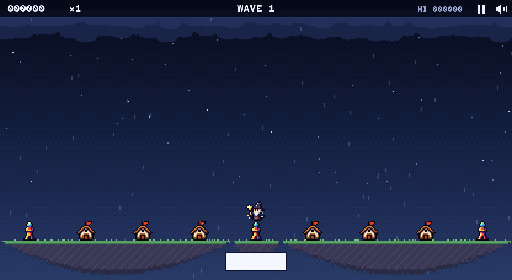

<div align="center">

# Storm Wizard

**Type the answer. Strike the hail.**

An arcade math game: hail falls on the sky islands, and every stone carries a sum. Answer it and your lightning finds it. It runs in the browser with a keyboard, mouse, controller or touch screen.

### [▶ Play it now](https://leeeeeroyj.github.io/storm-wizard/)

[](https://github.com/leeeeeroyj/storm-wizard/actions/workflows/deploy.yml)


[](LICENSE)



</div>

## About

Storm Wizard is an original arcade game inspired by the mechanics of Atari's 1980 arcade game *Missile Command*, rebuilt to drill the four math operations. The game is being built in the open; this is how it plays today.

- **The islands under the storm.** Three floating islands hold three towers and six cottages, with the Storm Wizard on the centre tower, under a drifting cloud deck and falling rain.
- **Made to be read.** Every number uses Atkinson Hyperlegible, a typeface designed so that similar letters and digits are easy to tell apart.

## How to play

Press **START** (Enter, A on a controller, or a click or tap) to go from the title to the islands. The hail, the answers and the lightning come next.

## Controls

| Action | Keyboard + mouse | Controller | Touch |
|---|---|---|---|
| Start | Enter or Space, or click START | A or Start | Tap START |

## Run it locally

You need [Node.js](https://nodejs.org/) `^20.19.0` or `>=22.12.0`.

```bash
npm install
npm run dev      # http://localhost:5173
npm run build    # type-check and build to dist/
```

Every push to `main` builds the game and deploys it to GitHub Pages.

## Project layout

```
assets/          served as-is: sprites/ (16×16 PNGs) and fonts/ (with their licences)
design/          concept sheet, sprite candidates and the build plan
docs/            the screenshot above
src/
  main.ts        boots Phaser, loads the fonts
  config.ts      every tunable in one place
  sky.ts         the sky, clouds, rain and islands, drawn in code
  islands.ts     towers, cottages and the wizard
  scenes/        Title, Sky (the game) and Hud
tools/           sprite picker (sprites.py) and the headless-Chrome tests
```

## Credits

- **Sprites:** from the CC0 [Angais/pixel-art-atlas-1.4m](https://huggingface.co/datasets/Angais/pixel-art-atlas-1.4m) collection of AI-generated pixel art, found with [Pixel Search](https://huggingface.co/spaces/cfahlgren1/pixel-search).
- **Fonts:** [Pirata One](https://fonts.google.com/specimen/Pirata+One) by Rodrigo Fuenzalida and Nicolas Massi, and [Atkinson Hyperlegible Next](https://fonts.google.com/specimen/Atkinson+Hyperlegible+Next) and [Atkinson Hyperlegible Mono](https://fonts.google.com/specimen/Atkinson+Hyperlegible+Mono) by the Atkinson Hyperlegible Project Authors (all SIL Open Font License).
- **Engine:** [Phaser](https://phaser.io/).
- **Inspiration:** Atari's *Missile Command*. Storm Wizard is an original game and isn't affiliated with or endorsed by the original's rights holders.

## License

The code is released under the [MIT License](LICENSE). The sprites in `assets/sprites/` and `design/` are CC0 (public domain), and the fonts in `assets/fonts/` are under the SIL Open Font License.
